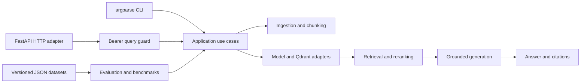

# Technical Manual

This manual is the implementation-level inventory for the RAG pipeline. It
explains which technologies are currently used, where each one fits, and which
trade-offs or limitations matter in a production discussion.

- **Project version:** 0.3.0
- **Last verified:** 2026-10-21
- **Current product surface:** Local Python CLI, manual SharePoint,
  Confluence, Google Drive, Slack, and Teams imports, and read-only HTTP API

## How To Read Version Information

The repository has three different version concepts:

1. `pyproject.toml` declares supported dependency ranges and the minimum Python
   version.
2. `uv.lock` records the exact reproducible dependency graph used by local
   development and CI.
3. Model identifiers and optional model revisions are runtime configuration,
   independent of Python package versions.

The locked versions below are a snapshot, not a second dependency source.
Always change constraints in `pyproject.toml` and refresh `uv.lock` with
`uv lock`.

## Stack At A Glance

| Area | Technology | Responsibility in this project |
| --- | --- | --- |
| Language | Python 3.11+ | Implements the CLI, application services, RAG stages, validation, and tests. |
| RAG contracts | LangChain | Supplies common document, embedding, prompt, model, parser, and vector-store interfaces. |
| CLI | `argparse` | Defines all commands, options, validation handoff, and terminal entry points without an extra CLI framework. |
| HTTP adapter | FastAPI and Uvicorn | Serve bearer-protected retrieval and answer routes over an existing local collection on loopback. |
| HTTP authentication | FastAPI HTTPBearer plus Python `hashlib` and `hmac` | Validate a shared admin secret and optional distinct query-principal tokens using fixed-size digests without an identity provider. |
| HTTP source policy | Pydantic and Qdrant payload filters | Validate a private manual grant file and constrain dense/hybrid queries by exact source before top-k selection. |
| HTTP request logging | Starlette ASGI middleware and Python `logging`/`json` | Emit bounded JSON events to stderr and correlate handled responses without storing request content. |
| HTTP monitoring | Prometheus Python client | Expose bearer-protected process-local request and RAG outcome aggregates with bounded labels. |
| HTTP schemas | Pydantic | Validates request limits and serializes selected provenance and citations. |
| Dense embeddings | LangChain Hugging Face + Sentence Transformers | Converts chunks and questions into normalized dense vectors for semantic search. |
| Sparse embeddings | FastEmbed through LangChain Qdrant | Produces BM25 sparse vectors for optional lexical retrieval. |
| Generation | Hugging Face Transformers through LangChain | Runs a local text-to-text model for grounded answer generation. |
| Reranking | Sentence Transformers CrossEncoder | Jointly scores query and chunk pairs after first-stage retrieval. |
| Vector storage | Embedded Qdrant | Persists vectors and metadata and executes dense or hybrid similarity search. |
| Text splitting | LangChain Text Splitters | Provides recursive and Markdown-aware hard boundaries for chunks. |
| HTML extraction | Python `html.parser` | Removes markup and non-content elements while preserving readable block and table text. |
| PDF extraction | pypdf | Extracts one provenance-bearing document per PDF page. |
| DOCX extraction | docx2txt | Extracts a Word document as one logical text document. |
| SharePoint import | MSAL and HTTPX | Obtains app-only Graph tokens and reads bounded drive listings and file content for manual local indexing. |
| Confluence import | HTTPX and existing HTML parser | Reads bounded Cloud space pages with API-token credentials and normalizes Storage-HTML for manual local indexing. |
| Google Drive import | Google Auth and HTTPX | Refreshes scoped ADC tokens and reads bounded Drive v3 folder listings, blob files, and native Docs exports for manual local indexing. |
| Channel imports | HTTPX and MSAL | Read bounded Slack or Teams channel threads; Teams reuses app-only Graph authentication and the HTML parser. |
| Data contracts | JSON and Markdown | Store synthetic corpora, evaluation labels, benchmark artifacts, and human-readable reports. |
| Evaluation | Project-owned Python | Computes deterministic retrieval, answer, abstention, citation, latency, and regression metrics. |
| Dependency management | uv | Creates the environment, resolves and locks dependencies, runs tools, and builds packages. |
| Packaging | setuptools | Builds the typed `src`-layout package as a wheel and source distribution. |
| Local container packaging | Docker and uv | Build a runtime-only Python 3.11 image from the locked environment; run CLI indexing and the API sequentially with persistent volumes. |
| Tests | `unittest` | Runs deterministic unit and local integration tests without network access. |
| HTTP tests | Starlette TestClient and `httpx2` | Exercise ASGI routes and lifespan with provider doubles. |
| Formatting and linting | Ruff | Enforces formatting, imports, naming, correctness, and selected performance rules. |
| Static typing | mypy | Checks all production modules in strict mode. |
| Coverage | Coverage.py | Measures branch coverage and enforces an 80 percent minimum. |
| CI and image delivery | GitHub Actions and GitHub Container Registry | Run locked quality checks on PRs, `main`, and release tags; smoke-test PR containers and publish a versioned image from validated tags. |
| Version control | Git and GitHub | Provide reviewable branch history, pull requests, release tags, and benchmark commit provenance. |

## Library Inventory

This consolidated table lists every runtime, development, and build dependency
declared in `pyproject.toml`, plus directly imported or operationally important
transitive libraries. Package names are distribution names used by the package
manager, which can differ from Python import names.

- **Direct runtime:** explicitly declared application dependencies, even when
  their functionality is reached through another library's adapter.
- **Transitive:** installed through another dependency rather than separately
  declared by this project. Inclusion here does not make it a direct dependency.
- **Development:** tools declared in the `dev` dependency group.
- **Build:** the backend declared under `[build-system]`.

| Library / package | Dependency type | Purpose and use in this project |
| --- | --- | --- |
| `langchain` | Direct runtime | Declares the RAG framework family; concrete application imports use its core contracts and integration packages below. |
| `fastapi` | Direct runtime | Defines the local read-only HTTP app, bearer security scheme, OpenAPI schema, routes, and exception mapping. |
| `uvicorn` | Direct runtime | Runs the ASGI app on a local listening socket. |
| `prometheus-client` | Direct runtime | Maintains an app-owned registry of HTTP and RAG outcome counters, a latency histogram, and an in-flight gauge; renders `/metrics`. |
| `starlette` | Transitive | Provides FastAPI's ASGI request/response and test-client infrastructure. |
| `langchain-core` | Transitive | Supplies `Document`, `Embeddings`, model, prompt, parser, and runnable contracts across ingestion, retrieval, generation, and tests. |
| `langchain-huggingface` | Direct runtime | Provides `HuggingFaceEmbeddings` for dense vectors and `HuggingFacePipeline` for local answer generation. |
| `langchain-qdrant` | Direct runtime | Adapts Qdrant retrieval and supplies sparse-vector contracts and the `FastEmbedSparse` provider. |
| `langchain-text-splitters` | Direct runtime | Creates bounded recursive chunks, including language-aware separator policies for structure-aware experiments. |
| `qdrant-client` | Direct runtime | Opens embedded Qdrant, manages collections and point writes, and defines vector, query, and metadata-filter models. |
| `sentence-transformers` | Direct runtime | Executes dense embedding models through the Hugging Face adapter and the optional `CrossEncoder` reranker. |
| `transformers` | Direct runtime | Loads local text-to-text models and tokenizers through the generation adapter. |
| `sentencepiece` | Direct runtime | Supplies tokenizer support for the default T5-family generation model. |
| `fastembed` | Direct runtime | Provides local BM25 sparse embeddings through `FastEmbedSparse` when hybrid retrieval is enabled. |
| `pypdf` | Direct runtime | Extracts PDF text page by page so document metadata retains citation page identity. |
| `docx2txt` | Direct runtime | Extracts DOCX text as one logical document without claiming stable rendered page numbers. |
| `httpx` | Direct runtime | Sends bounded Microsoft Graph, Confluence Cloud, Google Drive, and Slack requests; handles the SharePoint content redirect without forwarding its bearer token. |
| `msal` | Direct runtime | Acquires app-only Microsoft Graph tokens from an Entra client credential supplied through environment variables. |
| `google-auth[requests]` | Direct runtime | Discovers and refreshes scoped Application Default Credentials for the manual Drive import. |
| `requests` | Transitive | Provides the Google Auth token-refresh transport; Drive content requests use HTTPX instead. |
| `torch` (PyTorch) | Transitive | Executes dense embedding, generation, and reranking models; benchmark provenance also inspects its CUDA information lazily. |
| `numpy` | Transitive | Supplies numerical arrays used by the model and vector-provider stack, including reranker score outputs. |
| `tokenizers` | Transitive | Supplies optimized tokenization used by supported Hugging Face and FastEmbed models. |
| `onnxruntime` | Transitive | Supplies FastEmbed's ONNX model support; the current BM25 sparse path is lexical, not neural ONNX inference. |
| `pydantic` | Direct runtime | Supports provider contracts and defines the API's bounded request and response schemas. |
| `httpx2` | Development | Backs the current Starlette TestClient used in deterministic HTTP tests. |
| `ruff` | Development | Checks and formats source and tests, including imports and the configured correctness rules. |
| `mypy` | Development | Statically checks production code with the project's strict typing configuration. |
| `coverage[toml]` (Coverage.py) | Development | Measures statement and branch coverage for the offline test suite and enforces the configured coverage floor. |
| `setuptools` | Build | Implements the `setuptools.build_meta` backend that packages the typed `src` layout into wheels and source distributions. |

Python standard-library modules such as `argparse`, `html.parser`, `pathlib`, `dataclasses`,
`json`, `sqlite3`, and `unittest` do not require separate package installation.
Python, uv, Git, GitHub, and GitHub Actions are tools or platforms, not additional
application libraries; their responsibilities appear in **Stack At A Glance**
and **Engineering Toolchain**.

The table is an application-stack inventory, not an exhaustive software bill of
materials. Indirect implementation dependencies remain authoritative in
`uv.lock`; do not mistake every locked package for a library imported by project
code. Inspect the complete graph, including development tools, without changing
the lockfile or accessing the network:

```powershell
uv tree --locked --offline --all-groups
```

The default tree is filtered for the current interpreter and platform. Add
`--universal` to inspect the lockfile graph across supported environments;
platform-specific packages in that graph are not necessarily installed locally.

## Direct Dependencies

These are the runtime dependencies declared by the project. The locked snapshot
reflects `uv.lock` as verified on the date at the top of this document.

| Package | Declared range | Locked | Why it exists |
| --- | --- | --- | --- |
| `fastapi` | `>=0.115,<1.0` | 0.148.0 | Exposes typed local HTTP retrieval and answer routes. |
| `langchain` | `>=1.0,<2.0` | 1.3.13 | Declares the LangChain framework family used by the pipeline. |
| `langchain-huggingface` | `>=1.2,<2.0` | 1.2.2 | Adapts local Hugging Face embedding and generation models to LangChain contracts. |
| `langchain-qdrant` | `>=1.1,<2.0` | 1.1.0 | Connects LangChain retrieval contracts to Qdrant and exposes FastEmbed sparse embeddings. |
| `langchain-text-splitters` | `>=1.0,<2.0` | 1.1.2 | Supplies recursive character and language-aware splitters. |
| `pydantic` | `>=2.0,<3.0` | 2.13.4 | Defines and validates project-owned HTTP request and response models. |
| `prometheus-client` | `>=0.20,<1.0` | 0.26.0 | Exposes process-local, bearer-protected operational metrics without custom exposition code. |
| `qdrant-client` | `>=1.18,<2.0` | 1.18.0 | Runs the embedded Qdrant database and its query/filter API. |
| `sentence-transformers` | `>=5.2,<6.0` | 5.6.0 | Provides the dense embedding backend and cross-encoder reranker. |
| `sentencepiece` | `>=0.2,<1.0` | 0.2.2 | Supports tokenization for the default T5-family generation model. |
| `transformers` | `>=4.48,<5.0` | 4.57.6 | Loads the local text-to-text generation pipeline and tokenizer. |
| `uvicorn` | `>=0.30,<1.0` | 0.54.0 | Runs the local ASGI service. |
| `fastembed` | `>=0.3.3,<1.0` | 0.8.0 | Executes the optional local BM25 sparse model. |
| `pypdf` | `>=6.0,<7.0` | 6.14.2 | Reads text and page metadata from PDFs. |
| `docx2txt` | `>=0.9,<1.0` | 0.9 | Reads text from DOCX files. |
| `httpx` | `>=0.28,<1.0` | 0.28.1 | Implements read-only Microsoft Graph, Confluence Cloud, Google Drive, and Slack HTTP transports. |
| `msal` | `>=1.31,<2.0` | 1.39.0 | Acquires app-only Graph tokens for manual SharePoint and Teams imports. |
| `google-auth[requests]` | `>=2.38,<3.0` | 2.62.0 | Discovers and refreshes Drive read-only ADC credentials. |

The code imports `langchain_core` contracts directly; that package is currently
resolved through the declared LangChain family. The behaviorally important
transitive runtime snapshot is:

| Package | Locked | Runtime role |
| --- | --- | --- |
| `langchain-core` | 1.4.9 | Defines the document, embedding, prompt, model, parser, and runnable contracts imported by project code. |
| `torch` | 2.13.0 | Executes Sentence Transformers and Hugging Face model inference on CPU or CUDA. |
| `numpy` | 2.4.6 on Python 3.11; 2.5.1 on Python 3.12+ | Supplies array operations used by the ML provider stack and provider score outputs. |
| `tokenizers` | 0.22.2 | Provides optimized Hugging Face tokenization where supported by a model. |
| `onnxruntime` | 1.27.0 | Supplies FastEmbed's ONNX model support; the current BM25 path is lexical. |
| `starlette` | 1.9.0 | Supplies the ASGI request/response layer under FastAPI. |
| `requests` | 2.34.2 | Supplies the Google Auth refresh transport for ADC. |

These packages are locked in `uv.lock` rather than maintained as independent
application APIs. The full transitive graph contains additional implementation
dependencies and can be inspected with `uv tree`.

The build requirement is `setuptools>=68` with the `setuptools.build_meta`
backend. Its isolated build-environment version is not pinned in
`pyproject.toml`; a transitive setuptools entry in `uv.lock` is not a separate
exact build-backend pin.

Development tools are deliberately pinned exactly:

| Package | Version | Enforced behavior |
| --- | --- | --- |
| `ruff` | 0.16.1 | Formatting plus configured lint rule families. |
| `mypy` | 2.3.0 | Strict type checking under `src/rag_pipeline`. |
| `coverage[toml]` | 7.15.2 | Branch coverage with `fail_under = 80`. |
| `httpx2` | 2.14.0 | Supports offline ASGI route and lifespan tests through Starlette TestClient. |

## Architecture And Ownership



| Package | Ownership |
| --- | --- |
| `rag_pipeline.cli` | Parses terminal input, maps arguments to typed configuration, invokes services, and renders output. |
| `rag_pipeline.api` | Validates bearer credentials and bounded read-only HTTP requests, owns local provider lifecycle, emits sanitized request events and bounded metrics, and serializes source-cited JSON responses. |
| `rag_pipeline.application` | Coordinates transport-neutral indexing, retrieval, and answer workflows. |
| `rag_pipeline.ingestion` | Discovers files, extracts text, creates chunks, and runs chunking experiments. |
| `rag_pipeline.infrastructure` | Owns dense/sparse model adapters and Qdrant persistence. |
| `rag_pipeline.retrieval` | Defines retrieval policy, metadata filters, result provenance, and reranking. |
| `rag_pipeline.generation` | Owns prompt construction, token budgeting, model invocation, abstention, and citations. |
| `rag_pipeline.evaluation` | Loads labeled datasets and calculates deterministic retrieval and answer metrics. |
| `rag_pipeline.benchmarking` | Rebuilds isolated pipelines, records provenance and timing, compares artifacts, and enforces thresholds. |
| `rag_pipeline.exceptions` | Provides stage-specific errors shared across package boundaries. |

This is a layered modular monolith with CLI and local HTTP transports. The
application and feature services are shared; provider details stay at explicit
boundaries instead of being spread through command or route handlers. The API
is read-only and defaults to one shared bearer credential. Its optional local
query-principal policy authorizes exact indexed sources, but does not verify
external user identity or inherit source-system document permissions.

### Local HTTP Authentication Boundary

The API validates `RAG_API_BEARER_TOKEN` during lifespan startup and retains
only its SHA-256 digest in process state. FastAPI's HTTPBearer dependency gives
the query routes an OpenAPI security contract. Missing or incorrect credentials
receive the same `401` Bearer challenge before provider work; `/health` and
OpenAPI documentation remain public. The token is 32-256 URL-safe characters,
should be generated from at least 32 random bytes, and is rotated by restarting
the process. Without an access policy this shared secret allows all query
sources. With `RAG_API_PRINCIPALS_JSON` and `RAG_API_ACCESS_POLICY_PATH`,
distinct query tokens map to local principals and group memberships; the
shared token remains for `/metrics` only. The private versioned policy grants
exact indexed sources, denies missing sources, and is loaded once at startup.
Qdrant receives a server-derived source filter before top-k selection, while
the runtime rejects any returned source outside that scope before generation.
This does not sync remote ACLs, protect CLI/direct-store access, or provide SSO,
live revocation, TLS, rate limiting, or multi-tenancy. See
[the API policy guide](docs/API_REFERENCE.md#optional-source-access-policy).

### Local HTTP Request Logging

A pure ASGI middleware emits one JSON line per HTTP request to stderr with a
UTC timestamp, generated request ID, method, available route template, status,
and duration in milliseconds. It appends `X-Request-ID` to handled responses
for correlation. It neither trusts inbound IDs nor records bodies, headers,
query strings, raw paths, document text, or source metadata. The documented
Uvicorn command uses `--no-access-log` because its separate access logger can
record full request URLs. Error logs from Uvicorn or dependencies are separate;
request logs are not an audit trail. Monitoring metrics use a separate in-memory
registry.

### Local HTTP Monitoring

An app-owned Prometheus registry tracks HTTP request totals by method, route
template, and status; request durations in seconds by method and route; and an
unlabeled in-flight gauge. Completed retrieval and answer workflows also count
fixed outcome categories. `GET /metrics` uses the shared bearer guard and is
excluded from request metrics to avoid self-scrape skew. Unknown paths and
uncommon methods collapse to fixed labels; no questions, tokens, source paths,
or model identifiers become labels. The registry resets on restart and is not
aggregated across workers. These are operational indicators, not offline answer
quality metrics, tracing, alerting, or an identity-aware audit system.

## RAG Execution Flow

### 1. Discovery And Extraction

`pathlib` handles local paths and recursive discovery. Extractors normalize all
supported files to LangChain `Document` objects:

- `.pdf`: pypdf emits one document per page so citations retain page identity.
- `.docx`: docx2txt emits one logical document because Word pagination depends
  on rendering settings.
- `.txt`, `.md`, and `.markdown`: Python reads UTF-8 text by default without
  transforming Markdown markup.
- `.html` and `.htm`: the standard-library HTML parser removes tags, scripts,
  styles, head content, navigation, and templates. Visible headings, paragraphs,
  lists, table rows/cells, asides, and footers become normalized text.

Metadata includes the resolved source path, filename, extension, byte size,
extractor, and page information where available. HTML reports
`extractor=html.parser`, so filters on the former `extractor=text` value need
updating. HTML character offsets refer to the normalized extracted text; they
are not raw file positions. Reindex HTML sources to replace obsolete markup
chunks. The parser does not evaluate CSS visibility, extract image text, or
guarantee visual reading order. PDF OCR and layout reconstruction remain absent.

### 2. Chunking

The default strategy wraps LangChain's `RecursiveCharacterTextSplitter` and
preserves source metadata plus character offsets. Optional structure-aware
Markdown splitting keeps heading context where possible.

Semantic chunking is project-owned logic built on LangChain `Embeddings`. It
embeds buffered sentence windows, calculates adjacent cosine distances, and
places candidate boundaries above a configured percentile. Recursive splitting
still enforces hard maximum sizes, which prevents semantic grouping from
creating model-breaking chunks.

Trade-off: smaller chunks improve retrieval precision but may lose context;
larger or overlapping chunks improve continuity but increase embedding work,
storage, and prompt usage. Semantic chunking can improve topical coherence but
adds an embedding pass during ingestion, so it remains opt-in and benchmarked.
The [RQ-05 audit](docs/RQ05_EXTRACTION_CHUNKING.md) measured the pinned local
embedding tokenizer: no v2 strategy chunk exceeded its 256-token cap. The
synthetic HTML fixture did exceed it as raw markup but not after cleaning.
These observations do not justify a global token-aware splitter or a change
to recursive indexing defaults.

### 3. Dense Embeddings

The default dense model is
`sentence-transformers/all-MiniLM-L6-v2`. It produces 384-dimensional vectors,
runs on CPU by default, embeds documents in batches of 32, and normalizes
vectors for cosine search. The CLI configures model name, optional revision,
device, and batch size. Programmatic configuration can also disable
normalization, while current CLI workflows retain the normalized default.

`EmbeddingService` validates input text, provider result counts, numeric values,
finite values, and stable vector dimensions. Index and query paths share this
contract so model drift fails early instead of corrupting a collection.

Trade-off: MiniLM is small and accessible for local development, but a
production corpus may require a domain-specific or multilingual embedding model
validated against representative retrieval labels.

### 4. Sparse Embeddings And Hybrid Search

Hybrid mode adds FastEmbed's `Qdrant/bm25` sparse model. Sparse vectors capture
exact terms that dense semantic vectors may underweight, including identifiers,
names, and policy phrases. The default cache is `.rag_data/fastembed`, the
default batch size is 256, and CPU thread count is optional.

Qdrant fuses dense and sparse rankings with Reciprocal Rank Fusion (RRF). RRF
combines rank positions rather than incomparable cosine and BM25 raw scores. An
empty sparse query vector falls back to dense retrieval.

Trade-off: hybrid search can improve lexical recall, but it adds model storage,
index size, ingestion time, and another collection compatibility contract. The
default BM25 model's tokenization and stemming also need corpus-specific review.

### 5. Vector Storage And Indexing

`qdrant-client` runs Qdrant in embedded local mode:

- Persistent path: `.rag_data/qdrant`
- Default collection: `rag_documents`
- Distance metric: cosine for dense vectors
- Schemas: version 1 for dense and version 2 for hybrid collections
- Writes: synchronous, validated, and batched
- Identity: deterministic UUID-based point IDs for idempotent upserts

The CLI `index` workflow now replaces the full point set for each discovered
source. It snapshots existing source IDs, writes all new chunk vectors, then
deletes IDs absent from the new set. Empty sources therefore clear their old
points. `--prune-missing` explicitly adds absent files from one recursively
scanned directory to the replacement scope; sources outside that directory
remain untouched. The lower-level `LocalVectorStore.index()` method remains a
general upsert for benchmark and programmatic callers.

Replacement requires extra Qdrant reads and deletes. The synchronous batches
are not transactional as a group: extraction and embedding failures happen
before any write, while a Qdrant write or deletion failure may leave a partial
update. Repeating the same indexing operation reconciles the source scope.

The collection contract records and validates schema version, model identity,
vector dimension, named-vector layout, distance metric, and sparse settings.
Incompatible indexing or retrieval fails explicitly rather than mixing vectors
with different semantics.

The standard-library `sqlite3` module is used only to configure embedded
Qdrant's thread-safety behavior. The application has no separate SQL schema or
relational persistence layer.

Trade-off: embedded Qdrant keeps the prototype self-contained and exercises a
real vector database API. A multi-user production service would normally use a
separately operated Qdrant deployment with backups, authentication, encryption,
capacity planning, and availability controls.

### 6. Retrieval And Filtering

The retriever embeds the query with the same dense model contract used during
indexing. It supports:

- Dense cosine retrieval
- Optional dense plus BM25 hybrid retrieval
- Configurable `top_k` and candidate overfetch
- Optional minimum score threshold
- Repeatable exact scalar metadata filters with AND semantics
- Stable rank, score type, source metadata, and first-stage provenance

Metadata filters are translated to Qdrant conditions before top-k selection.
This is important for both relevance and future authorization because excluded
documents never enter the candidate set. Current filters are technical query
filters, not a complete RBAC or tenant-isolation implementation.

### 7. Cross-Encoder Reranking

The optional reranker uses
`cross-encoder/ms-marco-MiniLM-L6-v2` through Sentence Transformers. Unlike a
bi-encoder, it processes each query and candidate together, which usually gives
better ordering at higher inference cost.

Defaults are CPU execution, batch size 16, maximum pair length 512 tokens, and
cache path `.rag_data/rerankers`. First-stage ranks and scores remain attached
after reranking for auditability. Candidate width must be bounded because
latency grows approximately with the number of scored query-document pairs.

### 8. Prompting And Generation

The default generation model is `google/flan-t5-small`, loaded as a local Hugging
Face `text2text-generation` pipeline. LangChain composes a versioned
`PromptTemplate`, `BaseLanguageModel`, and `StrOutputParser` using its runnable
pipeline syntax.

Defaults are CPU execution, 128 maximum new tokens, deterministic decoding at
temperature 0, and a single-item generation batch. The application measures the
fully rendered prompt with the provider tokenizer, applies the configured input
limit, and reserves a safety margin before inference.

Only retrieved evidence that fits both character and token budgets enters the
prompt. With no usable evidence, generation is skipped and the exact abstention
response is returned. Citations are constructed deterministically from the same
accepted evidence and its metadata, never generated by the model.

Trade-off: FLAN-T5 Small makes the complete pipeline runnable on a CPU, but it
is a functional baseline rather than a production-quality answer model.

## Evaluation And Benchmarking

Evaluation is implemented in project-owned, deterministic Python rather than a
hosted judge model or an evaluation framework such as Ragas.

Retrieval evaluation uses versioned JSON datasets and reports per-case and macro
Precision@k, Recall@k, reciprocal rank, and MRR. Schema-v2 relevance labels use
source metadata and content anchors instead of unstable chunk indices.
Schema v3 preserves those positive selectors and adds explicit unsupported
questions with empty relevance sets. Positive macro metrics exclude negative
cases; negative cases separately report strict no-hit and false-positive rates.
Direct Python case construction still rejects an empty relevance set unless
`allow_empty_relevance=True` is passed; the v3 JSON loader supplies it for
negative cases, preserving the earlier constructor default.
Per-case diagnostics distinguish unique evidence selectors from overlapping
chunk hits and identify missing selectors and unwanted result ranks. The new
synthetic v3 corpus includes current and archived policy sources, but has no
paired answer-evaluation labels. V1/v2 report shapes remain unchanged.

With `evaluate-retrieval --compare-score-threshold`, the v3 evaluator reruns
the same queries for a baseline gate and one or more candidate gates through
one initialized retrieval pipeline. Its separate comparison report records
the requested search mode, exact gates, observed first-stage score kind per
case, existing metrics, lost/gained evidence selectors, and unwanted-hit
changes. The comparison excludes reranking to isolate the first stage and
never changes the index or the ordinary evaluator's JSON contract. Dense
cosine and hybrid RRF gates require separate calibration; an empty hybrid
sparse vector can fall back to cosine. `--no-score-threshold` explicitly
disables the gate on answer-oriented commands whose default remains `0.2`.
The [RQ-03 calibration record](docs/RQ03_SCORE_GATE_CALIBRATION.md) contains
the local synthetic-corpus measurements; they are not production thresholds.

With `evaluate-retrieval --rerank --compare-candidate-k`, a schema-v3 dataset
is rerun at `--candidate-k` and each distinct comparison width. The application
session exposes raw first-stage candidates and reranks exactly that pool,
without reloading Qdrant or the models for each query. The report compares
Recall@candidate-k, unreranked Recall@top-k, and reranked Recall@top-k, plus
per-case first-stage misses, final-selection losses, score kinds, and observed
retrieval/reranking wall time. Each width issues a real Qdrant query: hybrid
fusion need not yield a simple prefix of a wider result set. Compare dense and
hybrid collections separately against identical corpus and labels. Timings
include lazy initialization and are not latency benchmarks. The
[RQ-04 comparison record](docs/RQ04_CANDIDATE_RANKING.md) reports the small
synthetic experiment without changing defaults.

Answer evaluation reports normalized exact match, token F1, abstention accuracy,
abstention precision/recall, answer rate, and citation-behavior rate. These are
repeatable lexical and behavioral checks; they do not prove semantic
faithfulness or business correctness.

For paired schema-v2/v3 retrieval anchors and answerable cases, isolated
benchmarks also record which exact source spans survive retrieval and prompt
packing. The answer result retains the packed evidence prefixes used for
generation; diagnostics separate missing retrieval, lost packing, and model
abstention after packing. A non-abstaining answer is not automatically correct:
exact match and token F1 remain separate. Legacy or unpaired labels leave this
optional report absent, preserving existing artifact comparisons and gates.
The [RQ-06 measurement](docs/RQ06_EVIDENCE_COVERAGE.md) found full prompt
coverage at the default context cap on the synthetic v2 corpus, so it did not
justify a packing-policy change.

The benchmark runner rebuilds a temporary index from an exact corpus and records:

- Input, dataset, threshold-profile, and configuration fingerprints
- Package, platform, Python, Git, device, CUDA, and model provenance
- Stage duration plus per-case retrieval and answer latency
- Mean, p50, and p95 latency summaries
- Retrieval and answer quality metrics
- Optional per-anchor prompt-evidence diagnostics for paired source labels
- Index storage size and total runtime
- Compatible-run deltas and allowlisted regression gates

Benchmarks are one local measured pass. They are useful for reproducible
development comparisons but are not load tests and do not include warmups,
concurrency, confidence intervals, memory peaks, or hosted-provider costs.

## CLI And Configuration

The CLI uses only Python's `argparse`. The installed console script and module
entry point are equivalent:

```powershell
uv run rag-pipeline --help
uv run python -m rag_pipeline --help
```

Current commands are:

| Command | Purpose |
| --- | --- |
| `ingest` | Discover supported files and extract normalized documents. |
| `chunk` | Extract and split documents with the configured chunking policy. |
| `chunk-experiment` | Compare candidate recursive chunking configurations. |
| `embed` | Generate and validate dense chunk vectors. |
| `index` | Build or update a compatible dense or hybrid Qdrant collection. |
| `index-sharepoint` | Manually read one Graph drive and replace listed sources in a local collection; no ACL sync. |
| `index-confluence` | Manually read current Cloud space pages and replace listed sources; no ACL sync. |
| `index-google-drive` | Manually read one Drive folder and replace listed file sources; no ACL sync. |
| `index-slack` | Manually read one bot-visible Slack channel and replies; no ACL sync. |
| `index-teams` | Manually read one Graph-visible Teams channel and replies; no ACL sync. |
| `retrieve` | Search the collection with filters and optional reranking. |
| `answer` | Retrieve evidence and generate a grounded answer with citations. |
| `evaluate-retrieval` | Run labeled retrieval cases and report top-k metrics. |
| `evaluate-answer` | Run reference and abstention cases through the full answer path. |
| `benchmark` | Rebuild and measure an isolated end-to-end pipeline. |
| `compare-benchmarks` | Compare compatible artifacts and regression thresholds. |

CLI configuration uses flags and typed immutable dataclasses. The API reads
`RAG_API_*` environment values once at startup, including a required shared
bearer token. The tracked [.env.example](.env.example) lists the current API
and optional import variables; `.env` is not loaded automatically. Generation
and embedding remain local model providers.
The SharePoint importer additionally reads tenant ID, client ID, and client
secret from `RAG_SHAREPOINT_*` environment variables. Its default collection
is `sharepoint_documents`; the default store directory is unchanged. See
[the SharePoint setup and security contract](docs/SHAREPOINT.md).
The Confluence importer also reads a site root, account email, and API token
from `RAG_CONFLUENCE_*` environment variables. It defaults to a
`confluence_documents` collection in the same local store. See
[the Confluence setup and security contract](docs/CONFLUENCE.md).
The Google Drive importer uses scoped Application Default Credentials. An
optional `GOOGLE_APPLICATION_CREDENTIALS` path selects a credential file;
see [the Drive setup and security contract](docs/GOOGLE_DRIVE.md).
The Slack importer reads `RAG_SLACK_BOT_TOKEN` from the environment. The Teams
importer reads tenant, client, and secret values from `RAG_TEAMS_*`. Both
default to separate message collections in the same local store; see
[the channel setup and security contract](docs/CHANNELS.md).

## Local State And I/O

| Path or format | Content | Repository policy |
| --- | --- | --- |
| `.rag_data/qdrant` | Embedded vector database | Ignored by Git |
| `.rag_data/fastembed` | Sparse model cache | Ignored by Git |
| `.rag_data/rerankers` | Cross-encoder cache | Ignored by Git |
| Container `/app/.rag_data` | Embedded Qdrant plus optional sparse/reranker caches | Persist in a Docker volume; excluded from the image |
| Container `/app/.cache` | Hugging Face model files | Persist in a separate Docker volume; excluded from the image |
| Hugging Face cache | Dense and generation model artifacts | Managed outside tracked source |
| `evaluation/datasets` | Synthetic Markdown corpus and versioned JSON labels | Tracked |
| Benchmark JSON artifacts | Configuration, provenance, metrics, and timings | Written only when requested |
| Local `.env` files | Potential secrets | Ignored by default; tracked `.env.example` contains only blank credentials and documented local defaults, with no hosted-provider contract |
| Temporary SharePoint extraction files | Downloaded plaintext before parsing | Removed after each file; keep the host filesystem and Qdrant directory restricted |
| Temporary Google Drive extraction files | Downloaded plaintext before parsing | Removed after each file; keep ADC credential files outside the repository |

Model factories may download artifacts on first use. After caches are populated,
model inference runs locally without a hosted-provider API key. The HTTP adapter
still requires its locally generated bearer token. Default automated tests use
stubs and in-memory or temporary storage, so they require neither downloads nor
network access.

## Engineering Toolchain

### Dependency And Environment Management

uv is the single workflow for synchronization, execution, locking, and builds:

```powershell
uv sync --locked --dev
uv run rag-pipeline --version
uv lock --check
uv build
```

`pyproject.toml` is the editable dependency and package metadata source.
`uv.lock` is committed for reproducibility. The application version is read
from installed distribution metadata through `importlib.metadata`.

### Packaging

setuptools uses a `src` layout to prevent imports from accidentally resolving
against the repository directory. The package publishes a `py.typed` marker for
PEP 561 typing support and builds both wheel and source distributions.

### Tests And Quality Gates

The default suite uses standard-library `unittest`. Test doubles isolate model
providers, while temporary embedded Qdrant instances cover persistence and
retrieval integration deterministically.

```powershell
uv run ruff format --check .
uv run ruff check .
uv run mypy
uv run coverage run -m unittest discover -s tests
uv run coverage report
uv build
```

Ruff targets Python 3.11 and an 88-character line length. Mypy checks production
source in strict mode. Coverage measures branches and fails below 80 percent.

### Continuous Integration

GitHub Actions runs on pull requests, pushes to `main`, and version-tag pushes
with concurrency cancellation. The 30-minute quality job uses read-only
repository permissions, Ubuntu, Python 3.11, uv 0.11.32, locked dependencies,
Ruff, mypy, `unittest`, branch coverage, and package builds. After quality
passes, pull requests build the image and check the CLI and `/health` without
registry credentials. A release-tag job checks annotation, package version,
checked-out commit, and `origin/main` ancestry before building and testing the
same image. Only that job receives `packages: write`; it publishes a versioned
GHCR tag, not a mutable `latest` tag or a running service.

The package advertises Python 3.11, 3.12, and 3.13 classifiers, but CI currently
executes only Python 3.11. Additional matrix jobs would be required to claim
continuous verification on every advertised interpreter.

### Local Container Image

`Dockerfile` builds against the committed `uv.lock` with Python 3.11 and omits
development tools. A separate runtime stage receives only the non-editable
installed environment; `.dockerignore` allows just package inputs into the
build context. The API starts under a non-root user with Uvicorn access logging
disabled. Docker's health check calls `/health`, which checks liveness but not
collection or model readiness. The same image can run `rag-pipeline index`
before the API starts; both processes must not open the embedded Qdrant volume
at once. Named volumes retain Qdrant and model caches independently of the
container. See [the Docker workflow](docs/DOCKER.md) for exact commands and
security limits. The base image and uv image use versioned tags rather than
immutable digests, so the lockfile alone does not guarantee byte-identical
rebuilds. See [release images](docs/DOCKER.md#release-images) for the CI
publication workflow and remaining deployment limits.

## Deliberately Project-Owned Logic

LangChain provides interfaces and focused adapters, but the following behavior
remains explicit project code:

- File discovery and provenance normalization
- Provider response and vector validation
- Semantic breakpoint selection and hard chunk bounds
- Deterministic point identity and collection compatibility
- Metadata filter parsing and retrieval result provenance
- Reranking tie-breaking and score lineage
- Prompt token budgeting, abstention, and citation assembly
- Evaluation schemas, metrics, benchmark provenance, and regression gates

This keeps important business safeguards reviewable and testable instead of
hiding the entire application behind an opaque chain or agent abstraction.

## Not In The Current Stack

The following technologies or capabilities are not implemented in this code and
must not be presented as current behavior:

- Publicly deployable HTTP service, document uploads, or HTTP indexing
- OpenAI, Gemini, Claude, or other hosted model providers
- API-key loading from `.env`
- MCP servers, tool calling, or autonomous agents
- Verified per-user identity, OIDC/Keycloak integration, enterprise RBAC,
  tenant isolation, or synchronized source-system authorization
- Kubernetes, cloud deployment, or a remote Qdrant cluster
- Distributed workers, queues, schedulers, or streaming ingestion
- Production telemetry, tracing, dashboards, or alerting
- OCR, scanned-document understanding, or multimodal extraction
- LLM-as-a-judge, Ragas, or human evaluation workflows

These are valid production-evolution topics, but documenting them separately
prevents roadmap intent from being confused with delivered functionality.

## Maintenance Checklist

Review and update this manual after each coding task when that task changes any
of the following:

- Python support, direct dependencies, locked versions, or build backend
- Default models, model providers, revisions, devices, caches, or inference
  behavior
- File formats, chunking, embedding, storage, retrieval, reranking, prompting,
  generation, evaluation, or benchmark behavior
- CLI commands, configuration sources, APIs, authentication, or deployment
  surfaces
- Package ownership, data flow, persistent paths, schemas, or external I/O
- Test framework, quality thresholds, CI environment, or release process

For an affected change:

1. Inspect `pyproject.toml`, `uv.lock`, the changed implementation, and
   `.github/workflows/ci.yml` as applicable.
2. Update the relevant section and the `Last verified` date.
   When libraries change, also reconcile **Library Inventory**, the dependency
   tables, and actual imports; preserve the distinction between direct,
   transitive, development, and build dependencies.
3. Keep implemented behavior separate from roadmap plans.
4. Check consistency with `README.md`, `ARCHITECTURE.md`, and
   `CONTRIBUTING.md`.
5. Include the manual update in the same pull request as the technical change.

Pure internal edits that do not change any documented fact do not require
wording churn. The review should still confirm that the manual remains accurate.
